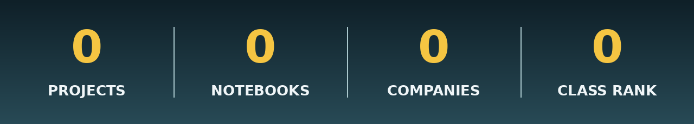
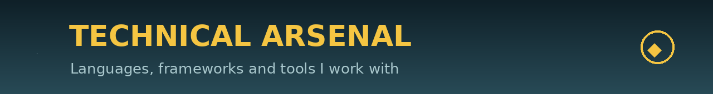

### AI Engineer | GenAI & LLMs | Machine Learning & Deep Learning | Computer Vision | Data Science & Analytics | AI Automation | Full-Stack Database Developer

**COO @ Capinex** &nbsp;|&nbsp; **Data Science Intern & QA Engineer @ DigiSync** &nbsp;|&nbsp; **BS AI, Hazara University — CGPA 3.95/4.0, Rank 1**

I'm **Muhammad Adnan**, an AI Engineer from Mansehra, Pakistan. I build end-to-end AI systems — from raw data and EDA to trained models, LLM-powered apps and live deployment.

- 🎓 **BS Artificial Intelligence**, Hazara University — **CGPA 3.95/4.0, 1st in class**
- 💼 **COO @ Capinex** (Jan 2026 – present) — leading day-to-day operations and cross-functional teams
- 📊 **Data Science Intern & QA Engineer @ DigiSync** (Jul 2026 – present) — ML models, EDA, data-driven decisions and quality assurance
- 🌱 Previously **ML Intern & UI/UX Intern @ NovaXccelerate**
- 🚀 Selected for **ACT-AI** — 8-week national AI training (HEC & Prime Minister's Initiative)
- 🔭 Current focus: **Generative AI, RAG systems, AI Agents, Computer Vision and AI Automation**

> *"The future of intelligence is not in knowing more, but in teaching machines to learn, adapt, and imagine what we cannot yet see."* — Adnan

| Area | What I deliver |
|---|---|
| **Generative AI & LLMs** | Chatbots and AI assistants, RAG pipelines over your own documents, prompt engineering, agentic workflows |
| **Machine Learning & Deep Learning** | Classification, regression and clustering — tuned and honestly evaluated; neural networks with TensorFlow |
| **Computer Vision** | Image classification and detection pipelines, from dataset prep to inference |
| **Data Science & Analytics** | EDA, statistical analysis, feature engineering and Power BI dashboards that drive decisions |
| **AI Automation** | Workflow automation that removes repetitive manual work from teams |
| **Full-Stack Database Development** | FastAPI backends, Streamlit apps, and MySQL/PostgreSQL schema design and queries underneath |

**AI / Machine Learning**

**Generative AI**

**Data, Databases & BI**

**Development & Tools**

| Project | What it does | Stack |
|---|---|---|
| **MediAI — Health AI Assistant** | Predicts likely conditions from symptoms, recommends doctors, secure medical records + generative chatbot | Python, AI/ML, FastAPI, GenAI |
| **[Crop Recommendation System](https://github.com/AdnanCodex/smart-crop-recommendation-system)** | Recommends the best crop from soil N/P/K + climate data; Random Forest, deployed via FastAPI | Scikit-Learn, Pandas, FastAPI |
| **Car Price Prediction Platform** | Regression for used-car prices with a full preprocessing pipeline and live FastAPI inference | Scikit-Learn, FastAPI, Pandas |
| **Mood Detection System** | NLP mood/sentiment classification from text using TF-IDF + supervised learning | NLP, TF-IDF, Scikit-Learn |
| **COVID-19 Analysis** | Global EDA on transmission & recovery trends with visual storytelling | Pandas, Matplotlib, Seaborn |
| **[SkyPulse Runner](https://github.com/AdnanCodex/skypulse-runner)** | An endless-runner game project | Game Dev, UI/UX |

**MediAI repo:** [health-ai-assistant---portal](https://github.com/AdnanCodex/health-ai-assistant---portal)

| Repository | What it holds |
|---|---|
| **[AI Engineering Notes](https://github.com/AdnanCodex/ai-engineering-notes)** | My complete learning notes in one place: Python for Data Science in full, plus a Machine Learning showcase (preprocessing, regression, classification, ensemble, unsupervised) and upcoming Deep Learning, Generative AI, FastAPI and Streamlit sections |
| **[Knowledge Representation & Reasoning](https://github.com/AdnanCodex/knowledge-representation-and-reasoning)** | First-Order Logic, Prolog, Protégé OWL ontologies, and a University Course Advisor project that cross-checks all three |

## 📊 GitHub Stats

**Open to AI/ML internships, collaborations and freelance ML projects — let's build something intelligent.**

